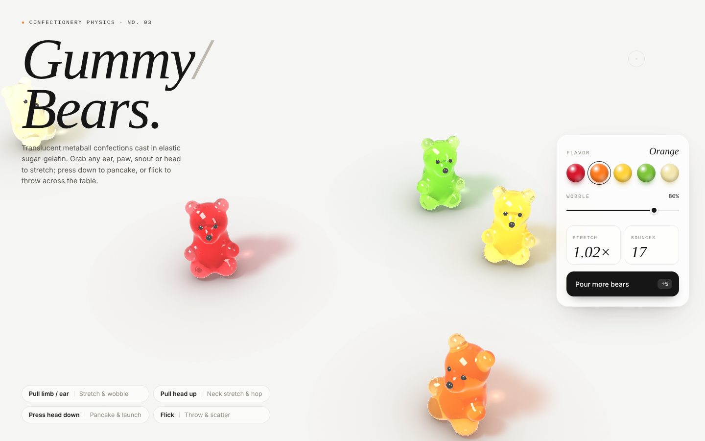
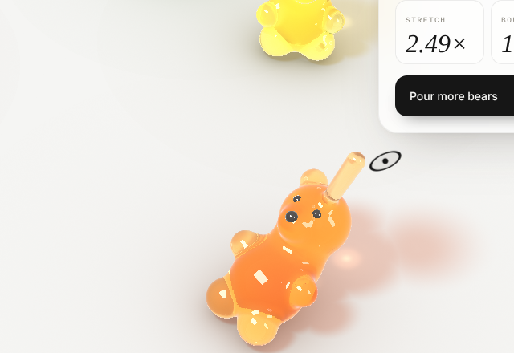
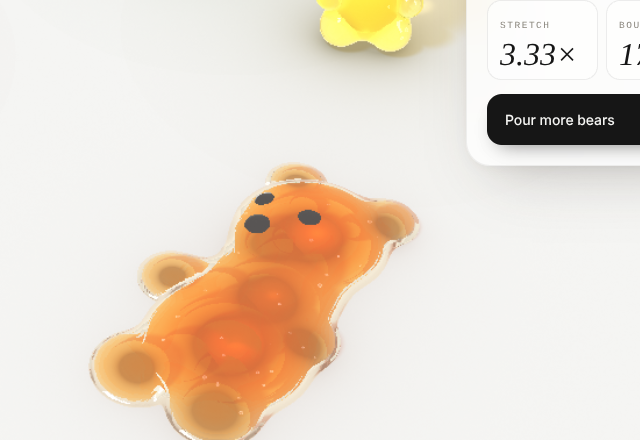
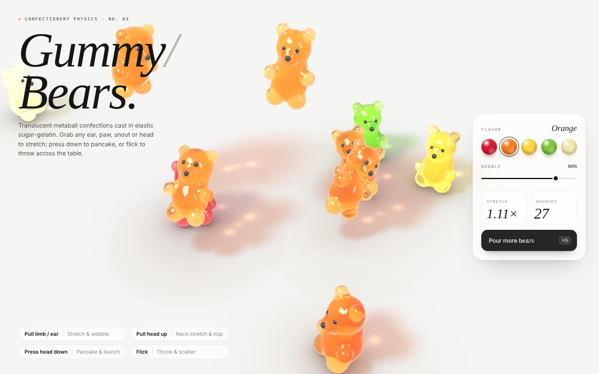
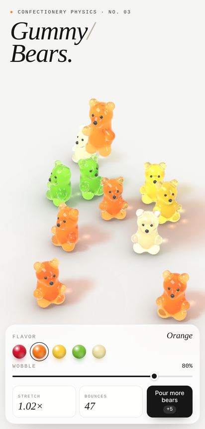

# Gummy/Bears.

[English](README.md) · **繁體中文**

**線上展示：** https://malilion.github.io/my-bear-jelly/



## 簡介

*Gummy/Bears.* 是一個小小的互動玩具：攝影棚桌面上擺滿半透明、Q 彈的軟糖小熊。你可以抓住牠們的耳朵、手腳、口鼻或頭部，把牠們拉成牛軋糖、壓成鬆餅再彈飛，或者一甩就讓牠們在桌上彈跳、互相碰撞。

**畫面中沒有任何方塊**：沒有多邊形網格、沒有體素、沒有精靈圖，也沒有任何貼圖圖片。GPU 只畫一個鋪滿螢幕的三角形，每一個像素都由 **有號距離場（SDF）光線步進（Raymarching）** 即時算出來。每隻小熊是一組平滑融合的圓角錐，每一幀都由自訂的彈簧質點物理推動。

- 單一 HTML 檔，HTML、CSS、GLSL 與 JavaScript 全部寫在一起
- 不用框架、不需建置，也不依賴任何外部資源（字型、CDN、圖片）
- 支援 WebGL2 的瀏覽器即可離線執行

## 快速開始

**方法一：直接開啟**

直接雙擊 `index.html`（會自動轉到 `gummy-bears.html`），或用 Chrome、Edge、Firefox、Safari 開啟 `gummy-bears.html`。

**方法二：使用靜態伺服器**

```bash
# 在專案資料夾執行以下任一指令
python3 -m http.server 8000
npx serve .
```

接著開啟 <http://localhost:8000/>。

> 需要 WebGL2。若瀏覽器不支援，頁面會顯示提示訊息，不會載入場景。

## 截圖展示

| 拉耳朵 | 往上拉頭 | 往下壓頭 |
| :---: | :---: | :---: |
|  |  |  |

| 倒入更多小熊 | 手機版 |
| :---: | :---: |
|  |  |

## 操作方式

| 操作 | 效果 |
| --- | --- |
| **拖曳**耳朵、手、腳或口鼻 | 拉長該部位（永遠和身體相連） |
| **往上拖曳頭部** | 拉長脖子；放開後小熊跳起來 |
| **往下拖曳頭部** | 把小熊壓成鬆餅；放開後彈飛 |
| **拖曳肚皮／胸腔** | 整隻抓起來移動 |
| **移動中放開** | 甩動：依指標的速度把小熊拋出去 |
| 點選 **FLAVOR** 色球 | 替最後碰過的小熊換口味（尚未碰過任何小熊時則全部換）；之後倒出的小熊也會是這個口味 |
| **WOBBLE** 滑桿 | 0% 偏硬、很快停止晃動；100% 非常 Q 彈 |
| **Pour more bears** 按鈕 | 從上方倒下 5 隻新小熊（最多 20 隻，最舊的會淡出） |

支援滑鼠、觸控與觸控筆。桌機上的游標是一個細圓圈加中心點：抓住時圓圈會縮小，下壓時會被壓扁，拉扯時會順著方向拉長。

## 玩法

小熊有四種互動方式，也列在頁面左下角：

1. **Pull limb / ear：拉長與晃動。** 被拉的部位會拉出一條越拉越細的果凍肉橋。拉力會透過結構彈簧傳到全身，小熊會順著拉的方向傾斜。放開後該部位像橡皮筋一樣彈回去，反作用力讓整隻小熊一起 Q 彈晃動。
2. **Pull head up：拉長脖子並跳起。** 頭往上拉時，胸腔和肚皮也被一起往上牽引，脖子拉長。放開後小熊彈跳起來。
3. **Press head down：壓成鬆餅再彈飛。** 所有節點向四周攤開、垂直壓扁成鬆餅，體積守恆，同時把彈性能量存起來。放開後小熊旋轉著高高彈飛。
4. **Flick：甩出與四散。** 抓住任何部位，在移動中放開就會把小熊拋出去。小熊落地時會被壓扁再彈起，連續彈跳好幾次，碰到牆壁會反彈，也會和其他小熊柔軟地互相碰撞。

右側卡片即時顯示兩個數字：

- **STRETCH：** 目前桌上最大的拉伸倍率。
- **BOUNCES：** 累計的落地彈跳次數。

被撞倒的小熊會慢慢自己站回來。

## 渲染技術

**幾何（SDF）**

- 每隻小熊有 10 個階層節點：肚皮（根節點）、胸腔、頭、口鼻、左右耳、左右手、左右腳。
- 除了肚皮，每個節點都是一個從父節點畫到自己的精確 **圓角錐 SDF（Round Cone）**，全部用多項式 **smooth-min** 融合。耳朵↔頭、口鼻↔頭、頭↔胸、雙手↔胸、雙腳↔肚皮永遠連在一起，不會斷成獨立的圓球。
- **體積守恆拉伸：** 每根骨頭的半徑乘上 `1 / sqrt(目前長度 / 原始長度)`。
- **鬆餅壓扁：** 在 SDF 空間套用體積守恆的非等比縮放 `(1/√s, s, 1/√s)`，同時節點本身也會往外攤開。
- 光亮的深色眼睛和鼻頭是獨立的小球，有自己的材質。

**軟糖材質**

- **折射**（折射率 1.45）進入糖體。在 SDF 內部再步進一次量出厚度，出口處再次折射，然後計算後方的景物（桌面與陰影）。
- **Beer–Lambert 吸收：** `exp(-σ·厚度)`，`σ` 由口味顏色決定。薄的耳朵透亮，厚的肚子顏色深而飽和。
- **次表面散射：** 在路徑中點做一次單次散射，並依主光柔光箱的光線穿過糖體的距離衰減。
- **內部微小氣泡：** 在小熊的本地座標中，於多個深度取樣雜湊 3D 格點，氣泡會跟著小熊移動與旋轉。
- **Fresnel**（Schlick）反射攝影棚環境，**兩盞矩形柔光箱**打出銳利的高光。

**攝影棚桌面**

- 米白色 `#f5f5f3`，和網頁背景無縫接合。
- **彩色柔和陰影：** 對每個節點與關節計算解析式球體軟陰影，並依穿透糖體的光上色。
- **焦散：** 軀幹與頭部下方出現聚焦的亮斑。
- **接觸環境光遮蔽（AO）：** 解析式球體遮蔽，帶一點小熊的顏色。

**效能**

- 每個像素先做包圍球剔除，只步進射線會碰到的小熊。
- 小熊資料存放在 Uniform Buffer。
- 高光壓縮只作用在比背景更亮的部分，所以頁面背景色完全不變。
- 依幀時間 **自動調整渲染解析度**。

**物理**

- 固定 240 Hz 步進。
- **形狀匹配（Shape Matching）**，以四元數極分解（Müller et al.）取出完整旋轉。
- **父子雙向骨架彈簧網路**，拉長時會像牛軋糖一樣越拉越硬。
- 依接觸點支撐，讓站著的小熊能撐住自己的重量。
- 整體橡膠式落地彈跳，落地時壓扁。
- 節點對節點的柔軟碰撞。
- 梯形牆面，和畫面中可見的桌面範圍一致。

## 專案結構

```
my-bear-jelly/
├── index.html            # 入口：自動轉到 gummy-bears.html
├── gummy-bears.html      # 整個應用程式，就這一個檔案
│   ├── <style>           #   版面、控制卡片、自訂游標、響應式設計
│   ├── <script id="vs">  #   全螢幕三角形的頂點著色器
│   ├── <script id="fs">  #   SDF 光線步進：小熊、軟糖材質、桌面、焦散
│   └── <script>          #   物理、點選與互動、介面連動、繪製迴圈
├── docs/
│   └── screenshots/      # README 使用的截圖
├── README.md             # English
└── README.zh-TW.md       # 繁體中文
```

## 授權

MIT © 2026 Malilion，詳見 [LICENSE](LICENSE)。
